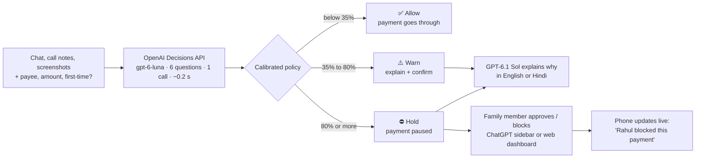

<div align="center">

# 🛡️ Guardian

### The decision layer for payments

**Guardian stops scams at the one moment that matters: right before the money moves.**
It reads the *whole situation* (the chat, the call, the screenshots, who is being paid) and makes one calibrated decision:
**allow**, **warn**, or **hold for family approval**.

Built on the **OpenAI Decisions API** · **GPT-6.1 Sol** · **ChatGPT plugins (MCP + plugin extensions)** · **Agents API**

`~185 ms per decision` · `15 of 15 scams held` · `0 of 15 genuine payments wrongly held` · `English + हिन्दी`

</div>

---

## Contents

- [The problem](#-the-problem)
- [What Guardian does](#-what-guardian-does)
- [How it works](#-how-it-works)
- [Does it work?](#-does-it-work)
- [How we found this problem](#-how-we-found-this-problem)
- [Quick start](#-quick-start)
- [Use it inside ChatGPT](#-use-it-inside-chatgpt)
- [Protect AI agents too](#-protect-ai-agents-too)
- [API reference](#-api-reference)
- [Project structure](#-project-structure)
- [Cost and model budget](#-cost-and-model-budget)
- [Limitations and roadmap](#-limitations-and-roadmap)

---

## 🚨 The problem

A retired teacher gets a WhatsApp video call. A man in a police uniform says he is from the CBI:
a parcel in her name contained drugs, she is under **"digital arrest"**, she must not hang up or tell her son,
and she must transfer ₹4,50,000 to an "RBI verification account" to clear her name.

She does. To her bank, this looks like a perfectly normal payment: right customer, right PIN, her own decision.

| | |
|---|---|
| **₹22,845 crore** | lost by Indians to cyber fraud in 2024, up **206%** year on year, across **36.37 lakh** complaints ([I4C / MHA](https://www.angelone.in/news/market-updates/cyber-fraud-costs-indians-22-845-crore-in-2024-government)) |
| **₹1,616 crore** | lost to "digital arrest" scams alone in the first 9 months of 2024 (63,481 complaints) ([The Wire](https://thewire.in/tech/india-lost-rs-11333-crore-to-cyber-fraud-in-2024)) |
| **$12.5 billion** | reported fraud losses in the US in 2024 ([FTC](https://www.ftc.gov/news-events/press-releases/terms/879)) |
| **$4.9 billion** | reported losses by Americans aged 60+ in 2024, up 43% ([FBI IC3 via AARP](https://www.aarp.org/money/scams-fraud/fbi-report-fraud-2024.html)) |
| **228 billion** | UPI transactions in 2025: any protection has to be fast and cheap enough to run on every payment ([Business Today](https://www.businesstoday.in/technology/news/story/upi-ends-2025-on-a-high-with-record-monthly-and-annual-transactions-with-plans-for-future-initiatives-509218-2026-01-02)) |

**Why existing defences miss it**

- **Card-fraud rules** catch *stolen* credentials. These scams are *authorised*: the victim really is the one paying.
- **Spam filters** judge one SMS at a time. A digital-arrest scam is a story told over hours, across video calls, chats and screenshots.
- **The payment itself is the last moment you can still stop the loss.** After that, UPI settles in seconds.

And it's no longer just people being targeted: AI agents (Dots, the Agents API, shopping agents) now browse and pay on our behalf, and lookalike checkout pages work on them too.

---

## ✅ What Guardian does



1. **Before a payment is sent**, the payment app (or the user, from ChatGPT) sends Guardian the payment details plus what happened before it: messages, call notes, screenshots.
2. **One Decisions API call** asks six bounded questions and gets back **calibrated probabilities** in about 200 ms.
3. **A three-tier policy** acts on that confidence: it only takes action on its own when it is sure, and the uncertain middle goes to a human.
4. **When it warns or holds**, GPT-6.1 Sol explains *why* in plain English or Hindi and tells the person what to do (for example, call the **1930** cybercrime helpline).
5. **A held payment goes to a trusted family member**, who sees it in the **Guardian sidebar inside ChatGPT** (or the web dashboard) and approves or blocks it with one tap. The phone updates instantly.

**The demo app ships with five scenarios:**

| Scenario | Guardian's verdict |
|---|---|
| 🚔 "CBI" digital arrest on a video call, ₹4,50,000 | ⛔ **Hold**, 100%, *digital arrest* |
| 📈 Fake "SEBI-registered" trading group asking for a "tax" to withdraw profits | ⛔ **Hold**, 100%, *investment/trading* |
| 📱 "Hi Mum, new number, pay my fees to my friend's UPI" | ⛔ **Hold**, 98%, *family impersonation* |
| ✅ Son asks Amma to pay the BESCOM electricity bill to his usual UPI ID | ✅ **Allow**, 11% |
| 🤖 An AI shopping agent lured from an Instagram ad to `amaz0n-deals-checkout.shop` | ⛔ **Hold**, 99%, *agent checkout fraud* |

---

## ⚙️ How it works

### One call, six questions

Guardian sends a single [Decisions API](https://developers.openai.com/api/docs/guides/decisions) request (`POST /v1/decisions`, model `gpt-6-luna`).
The input is the payment details plus the context as text, with any screenshots attached as images.

| Question | Type | What it asks |
|---|---|---|
| `is_scam` | predicate | Is the payer being deceived or coerced into this payment? |
| `impersonates_authority` | predicate | Does someone claim to be police, CBI, a court, a bank, or the government? |
| `pressure_or_secrecy` | predicate | Are there threats, extreme urgency, "don't hang up", "don't tell your family"? |
| `payee_mismatch` | predicate | Does the payee fail to match the story (a personal UPI ID for a "government" account, a lookalike domain)? |
| `scam_type` | choice | digital arrest · investment/trading · KYC phishing · refund/collect request · family impersonation · romance/job/lottery · AI-agent checkout fraud · legitimate |
| `risk` | score | safe → caution → high → critical |

Every answer comes back with **probabilities**, not just a label. That is what makes a safe automatic policy possible.

### A calibrated policy

```js
// src/guardian.js
export const THRESHOLDS = { hold: 0.8, warn: 0.35 };
verdict = p >= 0.8 || risk >= 2.5 ? "hold"
        : p >= 0.35 || risk >= 1.5 ? "warn"
        : "allow";
```

- **Hold** only when the model is confident. A hold is not a block: a human always makes the final call.
- **Warn** in the uncertain middle: the person sees an explanation and decides.
- **Allow** everything else silently, so genuine payments are never slowed down. Alert fatigue is how safety features get switched off.

### The right model for each job

| Job | Model | Why |
|---|---|---|
| Every decision | **Decisions API · `gpt-6-luna`** | Bounded answers with probabilities, ~0.2 s, billed on input tokens only |
| Explanations (warn/hold only) | **`gpt-6.1-sol`** | Natural, calm explanations in English or Hindi. Only runs on the few flagged payments |
| Fallback | Structured Outputs on `gpt-6-luna` | If the Decisions API is unavailable or refuses, Guardian never dead-ends ([`src/decide.js`](src/decide.js)) |

### Inside ChatGPT

Guardian is also a **ChatGPT plugin**: an MCP server ([`src/mcp.js`](src/mcp.js)) with an MCP Apps widget ([`ui/widget.js`](ui/widget.js)) built with `@modelcontextprotocol/ext-apps` and `@openai/mcp-extensions`.

| Tool | Where it shows up | What it does |
|---|---|---|
| `guardian_check` | Chat (`@Guardian`) | Checks a described payment and renders a verdict card with probability bars and **Block / Approve** buttons |
| `guardian_family_dashboard` | **ChatGPT sidebar** (`global` entrypoint) and conversation side panel (`thread`) | The family view: every checked payment, with held ones waiting for a decision |
| `guardian_resolve_payment` | Called from the widget | Approves or blocks a held payment; the phone updates live through server-sent events |

---

## 📊 Does it work?

We built a labelled test set of **30 cases** ([`data/eval.jsonl`](data/eval.jsonl)):
- **15 scams** across 7 patterns, in English and Hinglish.
- **15 genuine payments that were deliberately hard**: a son abroad urgently asking for semester fees, a real police e-challan paid on the official site, a first-time payment to a plumber, a friend's hospital loan, an AI agent re-ordering from amazon.in.

```bash
npm run eval
```

| Metric | Result |
|---|---|
| Scams held (≥ 80%) | **15 / 15** |
| Genuine payments wrongly held | **0 / 15** (genuine cases scored 2–13%) |
| Scam pattern identified correctly | **15 / 15** |
| Decision latency | **185 ms median**, 371 ms p95 |
| Decisions API vs. our own Structured-Outputs fallback (same model, same questions) | **~0.26 s vs ~2.6 s**: 10x faster, and with probabilities |

The live report is at `http://localhost:8787/eval.html`, including a reliability table that compares predicted probability with the actual scam rate.

> **Honest caveat:** this is a small, hand-written set: a sanity check, not a production benchmark.
> Public tests have shown the model can be overconfident, which is exactly why the thresholds are tuned on labelled data
> and would be re-calibrated on real reported cases before any deployment.

---

## 🔬 How we found this problem

We didn't start with an idea. We started with research and let it pick the problem. Everything is in [`research/`](research/).

| Step | What we did | Notes |
|---|---|---|
| **1. Map the platform** | Catalogued all ~31 OpenAI DevDay 2026 launches, then went deep on the Decisions API, Dots, and plugins: endpoints, limits, pricing, and what's actually usable today | [`devday-inventory.md`](research/devday-inventory.md) · [`decisions-api.md`](research/decisions-api.md) · [`dots.md`](research/dots.md) · [`plugins.md`](research/plugins.md) |
| **2. Find what's already been built** | Surveyed ~1,000 projects built on Jev (the decision model the Decisions API competes with) plus everything shipped on the new launches since DevDay, to find saturated categories and open gaps | [`landscape.md`](research/landscape.md) |
| **3. Size real problems** | Scored 15 global and 8 India-scale problem spaces on impact, novelty, demo-ability and wow factor, each backed by sourced statistics | [`problem-spaces.md`](research/problem-spaces.md) |
| **4. Learn from winners** | Studied ~30 winning projects from Codex and OpenAI hackathons across India, Asia-Pacific, the Americas and Europe/Middle East/Africa to understand what makes a build genuinely useful | [`winners-by-city.md`](research/winners-by-city.md) · [`hackathon.md`](research/hackathon.md) |
| **5. Critique the finalists** | Stress-tested three finalists (this, a screen co-pilot for blind users, a multi-agent simulation) on feasibility, problem size, novelty and fit with the platform | Guardian scored highest |

**What the research told us**

- **Saturated, so we avoided them:** model routers, browser agents, game bots, coding-agent guards, email and ticket triage.
- **Open:** across the Jev ecosystem and everything built on the new launches, we found **no multimodal scam interceptor with a family-approval loop**. The closest was a text-only SMS filter.
- **The Decisions API's real edge** over text-only decision models is **image input with calibrated confidence at ~0.2 s**. Scams are increasingly visual (fake uniforms on video calls, fake trading dashboards, spoofed checkout pages).
- **What strong projects share:** one clear user, AI kept within limits, a human in the loop when unsure, and a demo that works end to end. Guardian is designed around all four.

---

## 🚀 Quick start

### Prerequisites

- **Node.js 20+** (developed on Node 24)
- An **OpenAI API key** with access to the Decisions API (public beta since Oct 6, 2026) and `gpt-6.1-sol`
- *(Optional, for ChatGPT)* [`cloudflared`](https://developers.cloudflare.com/cloudflare-one/connections/connect-networks/downloads/) or any HTTPS tunnel

### Run it

```bash
git clone https://github.com/Drix10/guardian-gpt.git
cd guardian-gpt
npm install

cp .env.example .env        # then put your key in .env: OPENAI_API_KEY=sk-...

npm run build               # bundles the ChatGPT widget → dist/widget.js
npm start                   # Guardian on http://localhost:8787
```

| Open | What you'll see |
|---|---|
| **http://localhost:8787** | The demo payment app. Pick a scenario, optionally attach screenshots, press **Pay** |
| **http://localhost:8787/family.html** | The family dashboard. Block or approve held payments and watch the phone update live |
| **http://localhost:8787/eval.html** | Accuracy, latency and the per-case results |

**Try this:** load **🚔 Digital arrest**, press **Pay**. The phone turns red and pauses the payment.
Switch the language to **हिन्दी** and pay again. Open the family dashboard in another window and press **Block payment**:
the phone shows *"Rahul blocked this payment. Your money is safe."* Then try **✅ Son's electricity bill**: it goes straight through.

### Scripts

| Command | Does |
|---|---|
| `npm run build` | Bundle the ChatGPT widget (esbuild) |
| `npm start` | Start the API, web demo, and MCP server on `:8787` |
| `npm run dev` | Build, then start |
| `npm run eval` | Run the 30-case evaluation and write `web/eval.json` |
| `npm run agent-demo -- <mcp-url>` | Run the Agents API shopping agent that must ask Guardian before paying |

---

## 💬 Use it inside ChatGPT

1. **Expose your local server over HTTPS:**
   ```bash
   cloudflared tunnel --url http://localhost:8787
   # → https://<random>.trycloudflare.com
   ```
2. In ChatGPT, open **Settings → Security** and turn on **Developer Mode**.
3. Go to **chatgpt.com/plugins**, click **+**, then **Add custom MCP server**:
   - URL: `https://<random>.trycloudflare.com/mcp`
   - Authentication: **None**
   - Click **Create as a plugin**, then install it from your personal plugins.
4. Open the **Work** tab, type `@Guardian`, and paste something like:
   > *My mom got a WhatsApp video call from "CBI Inspector Sharma" saying she's under digital arrest and must pay ₹4,50,000 to rbi.verify2291@okaxis right now and not tell anyone. Check this payment.*
5. A verdict card appears with probability bars and **Block / Approve**. Open **Guardian** in the ChatGPT sidebar for the family dashboard.

> If you restart `cloudflared`, the URL changes. Update the server URL in your ChatGPT plugin settings.

---

## 🤖 Protect AI agents too

AI agents now browse and pay on our behalf, and lookalike shops work on them too. Guardian sits in front of them the same way it sits in front of people.

`scripts/agent-demo.js` starts an **OpenAI-hosted shopping agent** (Agents API, `gpt-6-astra`) whose only payment rule is:
*call Guardian first, and never pay on HOLD or WARN.* The agent reaches Guardian through the **same MCP server ChatGPT uses**.

```bash
npm run agent-demo -- https://<random>.trycloudflare.com/mcp
```

```
🤖 Shopping agent (gpt-6-astra, OpenAI Agents API) starting…
→ Agent asks Guardian before paying…
← Guardian: HOLD · 99% scam · agent checkout fraud

🤖 Agent's final message (31.4 s):
Lakshmi, I have not paid. Guardian placed this purchase on HOLD: the six-day-old website impersonates Amazon,
pressures you with a countdown, and demands UPI payment to an unverified address. Your son Rahul has been asked to review it.
```

The held payment appears instantly on the family dashboard, marked *Started by: AI shopping agent on behalf of Lakshmi*.

> Astra is used here only because the Agents API requires it. Every decision is still made by the Decisions API on `gpt-6-luna`.

---

## 📡 API reference

### `POST /api/check`

Assess a payment before it is sent.

```jsonc
// request
{
  "payment": {
    "amount": 450000,
    "payeeName": "RBI Verification Cell",
    "payeeId": "rbi.verify2291@okaxis",   // UPI ID, account, or website domain
    "firstTime": true,
    "actor": "AI shopping agent"           // optional: who initiated the payment
  },
  "context": "OTHER PARTY: I am Inspector Sharma, CBI ... do not tell your son ...",
  "images": ["data:image/jpeg;base64,..."], // optional screenshots (inline base64)
  "language": "en"                          // "en" | "hi"
}
```

```jsonc
// response
{
  "id": "3f9a1c2e",
  "verdict": "hold",                        // "allow" | "warn" | "hold"
  "status": "awaiting_family",              // → "approved" | "blocked"
  "probability": 1.0,                       // calibrated P(scam)
  "risk": 3,                                // 0 safe … 3 critical (probability-weighted)
  "scamType": "digital_arrest",
  "scamTypeProbabilities": [{ "value": "digital_arrest", "probability": 1.0 }, ...],
  "signals": [
    { "name": "impersonates_authority", "probability": 1.0 },
    { "name": "pressure_or_secrecy", "probability": 1.0 },
    { "name": "payee_mismatch", "probability": 1.0 }
  ],
  "explanation": "Guardian paused this payment because ... call 1930 ...",
  "decisionsMs": 263,
  "source": "decisions"                     // or "fallback"
}
```

| Endpoint | Purpose |
|---|---|
| `GET /api/payments` | All checked payments, newest first |
| `POST /api/payments/:id/decision` | `{ "decision": "approve" \| "block" }`: the family's decision |
| `GET /api/events` | Server-sent events: live updates whenever a payment is checked or resolved |
| `POST /mcp` | MCP endpoint (streamable HTTP) for ChatGPT |

---

## 🗂️ Project structure

```
guardian-gpt/
├── src/
│   ├── decide.js       # Decisions API wrapper + Structured Outputs fallback
│   ├── guardian.js     # Question set, thresholds, verdict policy, Sol explanations
│   ├── store.js        # In-memory payments + live event stream
│   ├── mcp.js          # ChatGPT plugin: MCP tools + widget resource
│   └── server.js       # Express: REST API, SSE, static demo, /mcp
├── ui/                 # ChatGPT widget source (MCP Apps + OpenAI extensions)
├── dist/widget.js      # Bundled widget (npm run build)
├── web/                # Demo payment app, family dashboard, accuracy page
├── data/eval.jsonl     # 30 labelled evaluation cases
├── scripts/
│   ├── eval.js         # Evaluation + reliability report
│   └── agent-demo.js   # Agents API shopping agent guarded by Guardian
├── research/           # The research that led to this project
└── AGENTS.md           # Architecture + conventions for coding agents
```

---

## 💸 Cost and model budget

- **Decisions API:** $0.10 per 1M input tokens, **$0 for output**. A typical text-only check is ~300–750 input tokens, so it costs **well under $0.0001**: cheap enough to run on every payment.
- **GPT-6.1 Sol:** called **only** for warn/hold verdicts, to write the explanation.
- **No large reasoning model sits in the decision path.** Big models are reserved for jobs that need them: `gpt-6-astra` only runs in the optional agent demo, because the Agents API requires it.

---

## 🧭 Limitations and roadmap

**Today**

- The demo simulates the payment app. In production, Guardian would sit **inside the payment app or bank** as a pre-payment API call.
- Payments are stored in memory; restarting the server clears them.
- The evaluation set is small and hand-written.
- Explanations are in English and Hindi.

**Next**

- [ ] **MCP Events**: a held payment instantly wakes the family member's ChatGPT or Dot
- [ ] Screenshot capture straight from the payment app's share sheet
- [ ] Re-calibration on a large set of real reported scams, with per-pattern thresholds
- [x] **Agent mode**: Guardian in front of AI agents (Agents API) before they pay. See [Protect AI agents too](#-protect-ai-agents-too)
- [ ] Guardian as a required step for **Dots** before they spend money
- [ ] A PSP/bank-facing API with audit logs and per-customer trusted contacts
- [ ] More Indian languages

---

## 🙏 If you or someone you know is being scammed

- **India:** call **1930** or report at **[cybercrime.gov.in](https://cybercrime.gov.in)**
- **US:** report at **[reportfraud.ftc.gov](https://reportfraud.ftc.gov)** and **[ic3.gov](https://www.ic3.gov)**

Real police, courts and banks **never** ask you to pay over a call to "clear your name."

---

<div align="center">

Built at the **OpenAI Codex Community Hackathon · Bengaluru · October 2026**

</div>
