# Guardian: pitch deck

All 11 slides, in order. Also available as one file: [**guardian-pitch-deck.pdf**](guardian-pitch-deck.pdf).

| # | Slide |
|---|---|
| 1 | 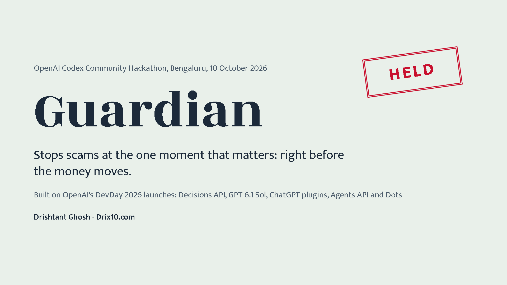 |
| 2 | 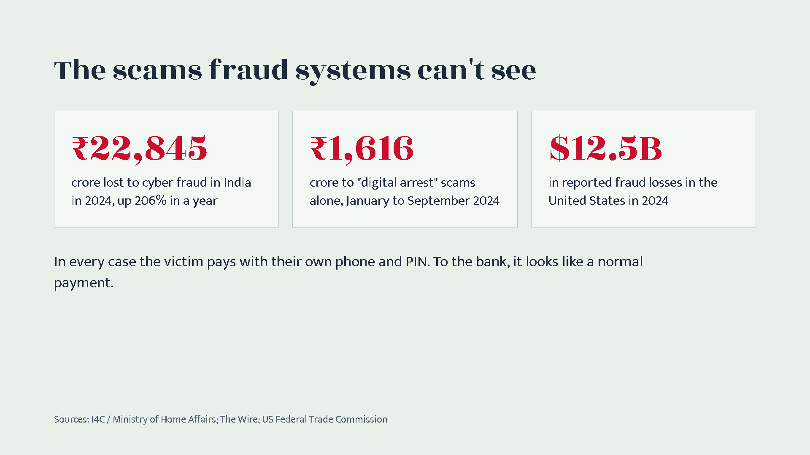 |
| 3 | 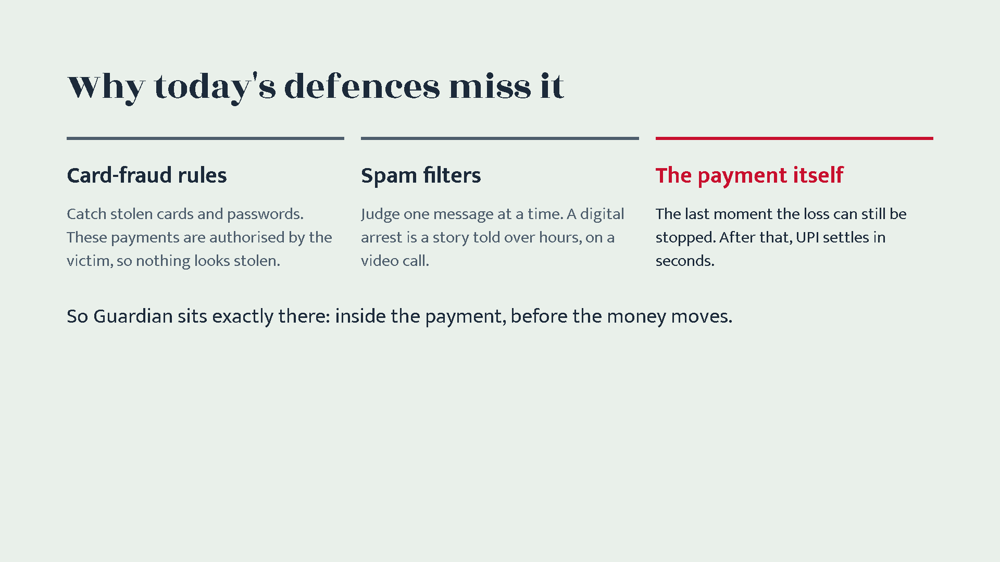 |
| 4 | 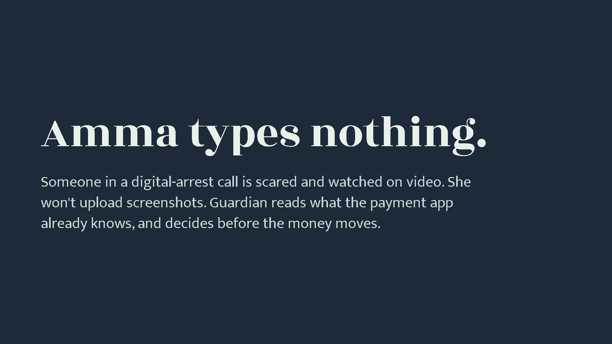 |
| 5 | 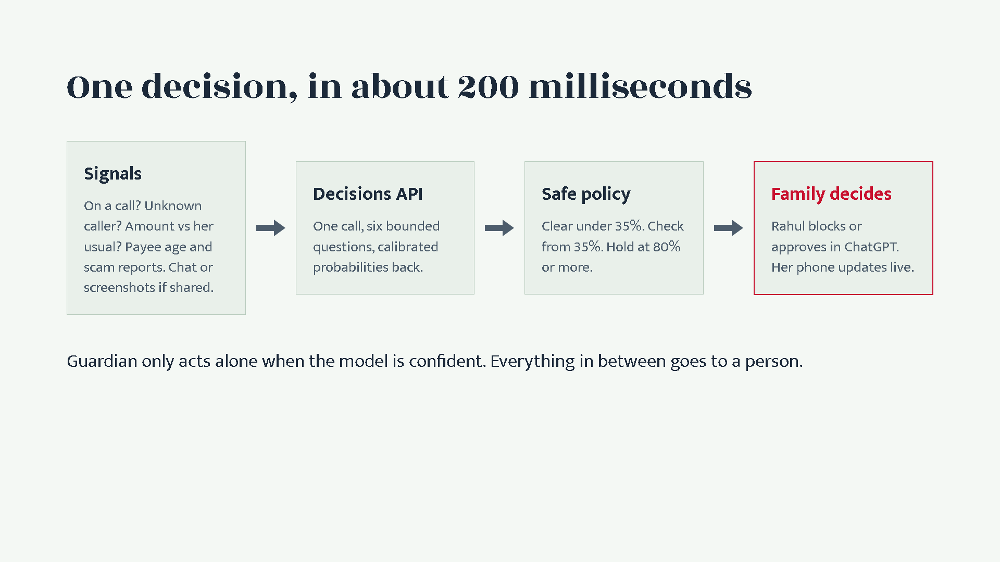 |
| 6 | 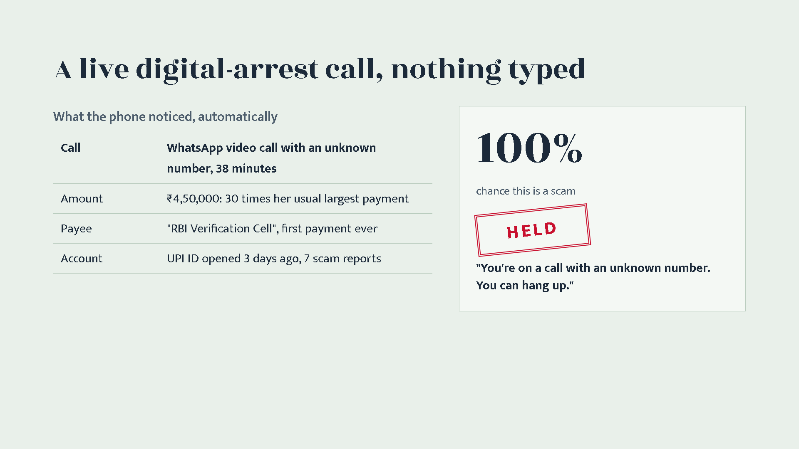 |
| 7 | 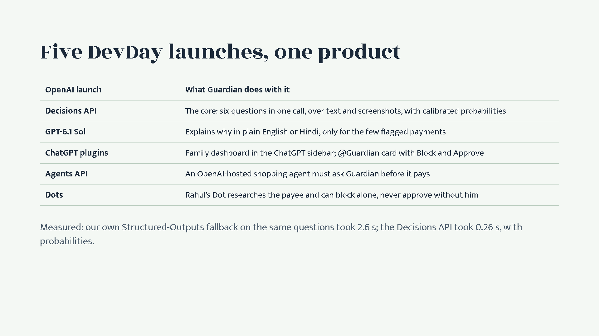 |
| 8 | 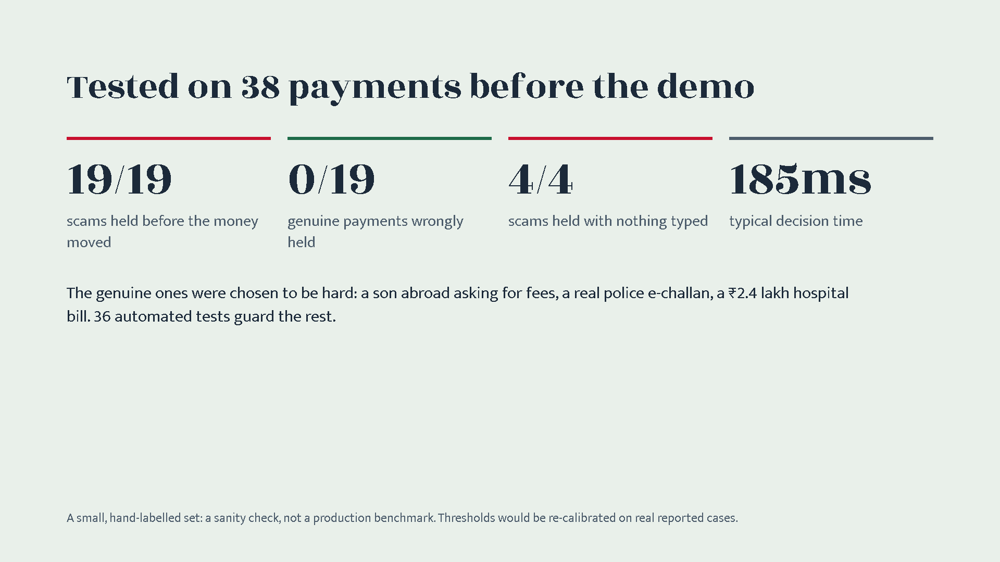 |
| 9 | 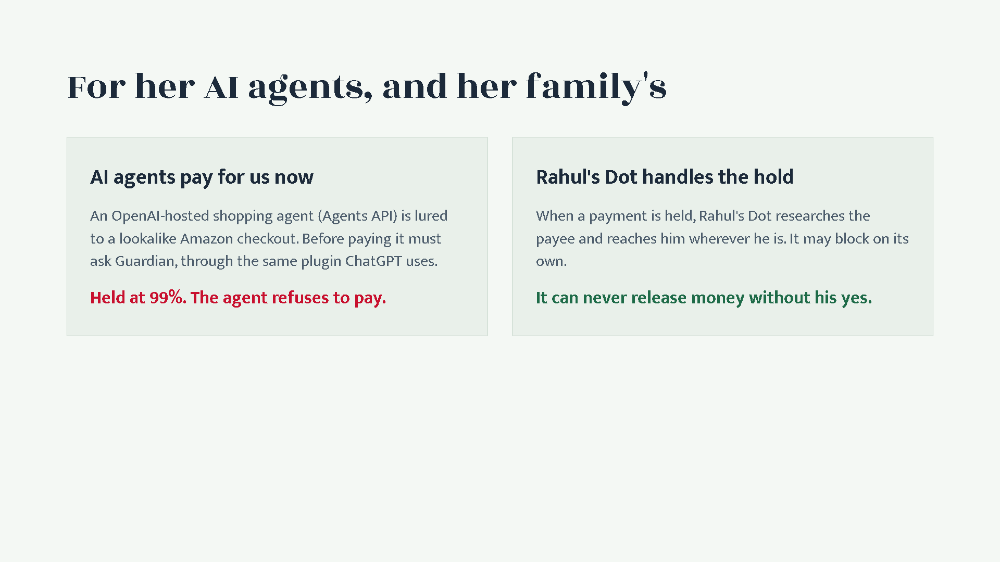 |
| 10 | 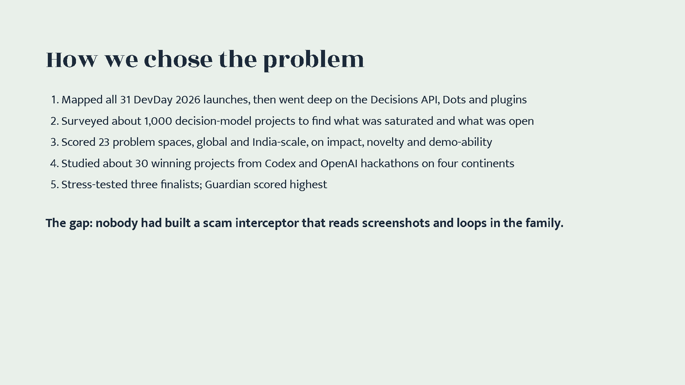 |
| 11 | 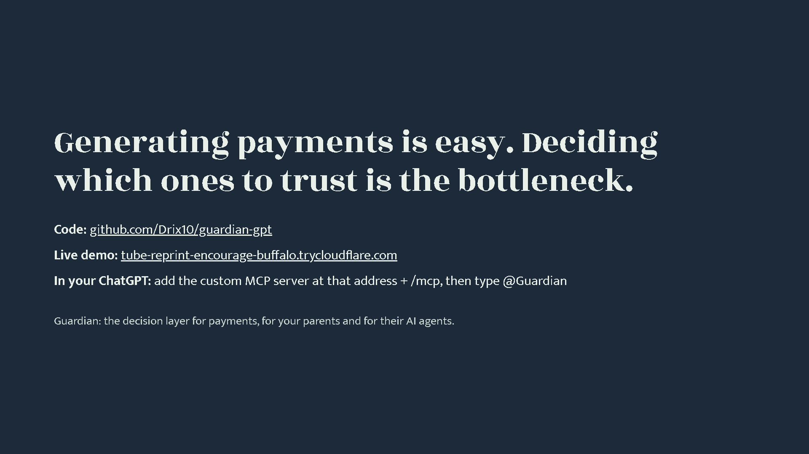 |
